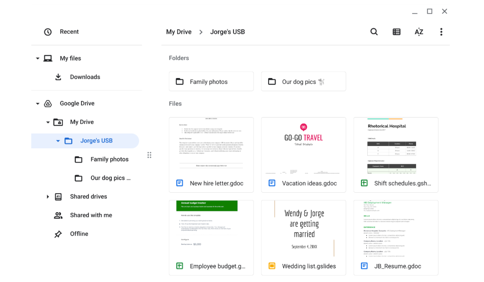

[Português](README.md) · **English**

# Analysis of a USB drive found in the parking lot (USB baiting)

> **Context:** Google Cybersecurity Professional Certificate (Assets, Threats, and Vulnerabilities course)
> **Skills:** USB baiting, social engineering, PII identification, attacker mindset, technical, operational and managerial controls

## Project description

In this activity, I was part of the security team at Rhetorical Hospital. When I arrived at work, I found a USB drive with the hospital's logo in the parking lot, and there was no one around who could have dropped it.

Instead of plugging the drive into a normal computer, I used a virtual machine isolated from the network to look at the contents safely, without opening any files. My job was to analyze what kind of information was on it, think about how an attacker could use this data and suggest controls against USB baiting attacks.

The completed exercise is in [`parking-lot-usb-en.pdf`](parking-lot-usb-en.pdf). There is also a Portuguese version in [`usb-no-estacionamento.pdf`](usb-no-estacionamento.pdf).

## What was on the USB drive

The drive seemed to belong to Jorge Bailey, the hospital's HR manager.

| File or folder | Type | Why it is sensitive |
|---|---|---|
| Family photos, Our dog pics | Personal | Show Jorge's family and routine |
| Vacation ideas | Personal | Travel plans |
| Wedding list | Personal | Names of relatives and guests |
| JB_Resume | Personal | Jorge's PII (contact info, work history) |
| New hire letter | Work | Data about a new employee |
| Shift schedules | Work | Who works at each time |
| Employee budget | Work | Hospital financial data |

## Analysis

**Contents.** The drive mixes personal and work files, and many of them have PII, like the resume and the wedding list. It also has sensitive hospital files, like the new hire letter, the shift schedules and the budget. Keeping all of this together on the same device is not safe.

**Attacker mindset.** With this information, an attacker could create a very convincing phishing email, pretending to be a relative of Jorge, a wedding guest or a new employee. The shift schedules show who works and when, which helps with social engineering attacks against other employees. With the new hire letter, they could even pretend to be HR.

**Risk analysis.** A drive like this could have hidden malware, like a keylogger or a backdoor. If another employee plugged it into a work computer, the whole hospital network could be infected.

| Control type | Recommendation |
|---|---|
| Technical | Block USB ports and have the antivirus scan every connected device |
| Operational | Train employees to give unknown USB drives to the security team |
| Managerial | Create a policy that forbids mixing personal and work files on the same device |

## What I learned

- The drive was a risk even without malware. The files alone were enough to plan an attack.
- USB baiting works because people are curious. That is why training is as important as technical controls.
- Using an isolated virtual machine and not opening the files was the right way to investigate without putting the hospital at risk.
- Keeping personal and work files separate reduces the damage if a device gets lost.
