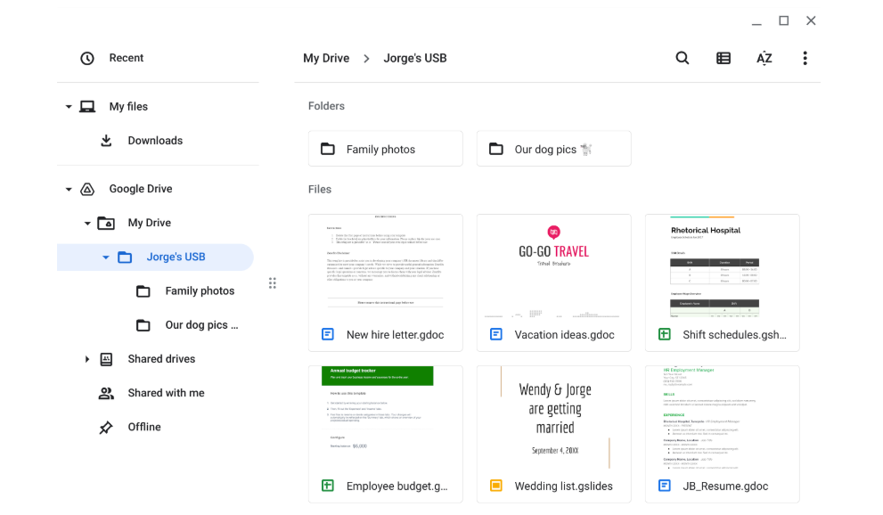

**Português** · [English](README.en.md)

# Análise de um pendrive encontrado no estacionamento (USB baiting)

> **Contexto:** Google Cybersecurity Professional Certificate (curso Assets, Threats, and Vulnerabilities)
> **Habilidades:** USB baiting, engenharia social, identificação de PII, mentalidade do atacante, controles técnicos, operacionais e gerenciais

## Descrição do projeto

Nesta atividade, eu fazia parte da equipe de segurança do Rhetorical Hospital. Chegando para trabalhar, encontrei no estacionamento um pendrive com o logo do hospital e ninguém por perto que pudesse ter deixado ele cair.

Em vez de conectar o pendrive em um computador comum, usei uma máquina virtual isolada da rede para ver o conteúdo com segurança, sem abrir nenhum arquivo. Meu trabalho foi analisar que tipo de informação estava ali, pensar como um atacante usaria esses dados e sugerir controles contra ataques de USB baiting.

O exercício preenchido está em [`usb-no-estacionamento.pdf`](usb-no-estacionamento.pdf). Também tem a versão em inglês em [`parking-lot-usb-en.pdf`](parking-lot-usb-en.pdf).

## O que tinha no pendrive

O pendrive parecia ser de Jorge Bailey, gerente de RH do hospital.

| Arquivo ou pasta | Tipo | Por que é sensível |
|---|---|---|
| Family photos, Our dog pics | Pessoal | Mostram família e rotina de Jorge |
| Vacation ideas | Pessoal | Planos de viagem |
| Wedding list | Pessoal | Nomes de parentes e convidados |
| JB_Resume | Pessoal | PII de Jorge (contato, histórico de trabalho) |
| New hire letter | Trabalho | Dados de um novo funcionário |
| Shift schedules | Trabalho | Quem trabalha em cada horário |
| Employee budget | Trabalho | Dados financeiros do hospital |

## Análise

**Conteúdo.** O pendrive mistura arquivos pessoais e de trabalho, e vários deles têm PII, como o currículo e a lista do casamento. Também tem arquivos sensíveis do hospital, como a carta de contratação, a escala de turnos e o orçamento. Guardar tudo isso junto no mesmo dispositivo não é seguro.

**Mentalidade do atacante.** Com essas informações, um atacante poderia criar um phishing bem convincente, fingindo ser um parente de Jorge, um convidado do casamento ou um novo funcionário. A escala de turnos mostra quem trabalha e quando, o que ajuda em ataques de engenharia social contra outros funcionários. Com a carta de contratação, ele poderia até se passar pelo RH.

**Análise de risco.** Um pendrive desses pode ter malware escondido, como um keylogger ou um backdoor. Se outro funcionário conectasse no computador do trabalho, a rede do hospital inteira poderia ser infectada.

| Tipo de controle | Recomendação |
|---|---|
| Técnico | Bloquear portas USB e fazer o antivírus verificar todo dispositivo conectado |
| Operacional | Treinar os funcionários para entregar pendrives desconhecidos à equipe de segurança |
| Gerencial | Criar uma política que proíba misturar arquivos pessoais e de trabalho no mesmo dispositivo |

## O que aprendi

- O pendrive era um risco mesmo sem ter malware. Só os arquivos já davam material suficiente para planejar um ataque.
- O USB baiting funciona por causa da curiosidade das pessoas. Por isso o treinamento é tão importante quanto o controle técnico.
- Usar uma máquina virtual isolada e não abrir os arquivos foi o jeito certo de investigar sem colocar o hospital em risco.
- Separar arquivos pessoais e de trabalho diminui o estrago se um dispositivo for perdido.
